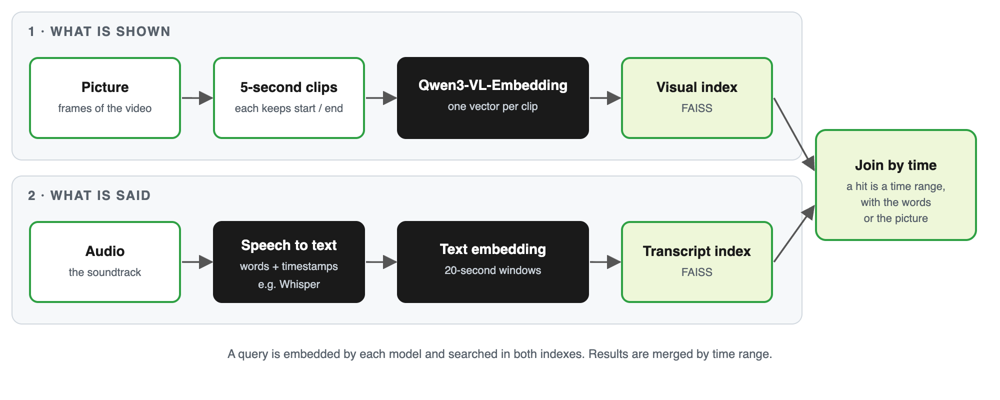

# Semantic video search with Qwen3-VL and FAISS

Search a video by meaning, with plain words or a reference image, using open models:

- **[Qwen3-VL-Embedding-8B](https://huggingface.co/Qwen/Qwen3-VL-Embedding-8B)** turns 5-second clips and still frames into vectors (Apache 2.0).
- **[FAISS](https://github.com/facebookresearch/faiss)** stores the vectors with each clip's start and end time, so a hit is a timestamp.
- **[Qwen3-VL-Reranker-2B](https://huggingface.co/Qwen/Qwen3-VL-Reranker-2B)** (optional) re-scores the top candidates (Apache 2.0).



This repository covers the **visual** half of the architecture in the blog post *Semantic Video Search for Media Archives*. The speech half (a separate ASR transcript index joined by time) is a design discussed in the post and is not implemented here.

## What is in this repository

| File | What it is |
| --- | --- |
| `video_search_qwen3_vl.ipynb` | The walkthrough: cut clips, embed, index, search by text and by image, rerank, read on-screen text. |
| `search_demo.py` | The same indexing and search as one runnable script. |
| `requirements.txt` | Python packages (tested versions). |

## Run it

1. **Install the packages**

   ```bash
   python -m venv .venv && source .venv/bin/activate
   pip install -r requirements.txt
   ```

2. **Get a video.** The notebook was run on *Meridian* (2016), a short film directed by Curtis Clark and released by Netflix and Xiph.org. Wikipedia lists it under the Creative Commons Attribution-NonCommercial-NoDerivatives 4.0 license. Check the terms at the source before reusing it. Save it as `data/meridian.mp4`, or point `VIDEO_PATH` at any video you may use.

3. **Start an embedding server** that speaks the OpenAI-style `/v1/embeddings` API. With [vLLM](https://docs.vllm.ai) on a GPU machine:

   ```bash
   docker run -d --rm --name qwen3-vl-embedding --gpus all \
     -v "$HOME/.cache/huggingface:/root/.cache/huggingface" \
     -p 127.0.0.1:8001:8000 vllm/vllm-openai:v0.21.0 \
     --model Qwen/Qwen3-VL-Embedding-8B --served-model-name Qwen/Qwen3-VL-Embedding-8B \
     --runner pooling --convert embed --dtype bfloat16 \
     --max-model-len 8192 --max-num-seqs 2 \
     --limit-mm-per-prompt '{"image":1,"video":1}' --enforce-eager
   ```

   Forward port 8001 to your machine if the server is remote (for example `ssh -L 18001:127.0.0.1:8001 <host>`), and set `BASE_URL` in the notebook to match (default `http://127.0.0.1:18001`).

4. **(Optional) start a reranker server** for section 7, or set `RUN_RERANK = False` in the notebook's config cell:

   ```bash
   mkdir -p ~/templates
   curl -fsSL -o ~/templates/qwen3_vl_reranker.jinja \
     https://raw.githubusercontent.com/vllm-project/vllm/main/examples/pooling/score/template/qwen3_vl_reranker.jinja
   docker run -d --rm --name qwen3-vl-reranker --gpus all --ipc=host \
     -v "$HOME/.cache/huggingface:/root/.cache/huggingface" -v "$HOME/templates:/templates" \
     -p 127.0.0.1:8000:8000 vllm/vllm-openai:v0.21.0 \
     --model Qwen/Qwen3-VL-Reranker-2B --runner pooling --max-model-len 4096 \
     --hf-overrides '{"architectures": ["Qwen3VLForSequenceClassification"], "classifier_from_token": ["no", "yes"], "is_original_qwen3_reranker": true}' \
     --chat-template /templates/qwen3_vl_reranker.jinja
   ```

   Set `RERANK_URL` in the notebook to its address (default `http://127.0.0.1:18000/v1`).

5. **Open the notebook** (`jupyter lab`) and run it top to bottom, or run `python search_demo.py`.

## Notes and limits

- Results were checked by eye on one film. There are no labeled queries, so no precision or recall numbers.
- The embedding model sees frames only, so spoken dialogue is not searchable without a separate transcript.
- Token limits depend on resolution and frame count, not duration. Keep clips short.
- The notebook's saved outputs are cleared. Run it to regenerate the results.

## License

Add your license here. The models are Apache 2.0 per their model cards. The video has its own license (see above) and is not included.
